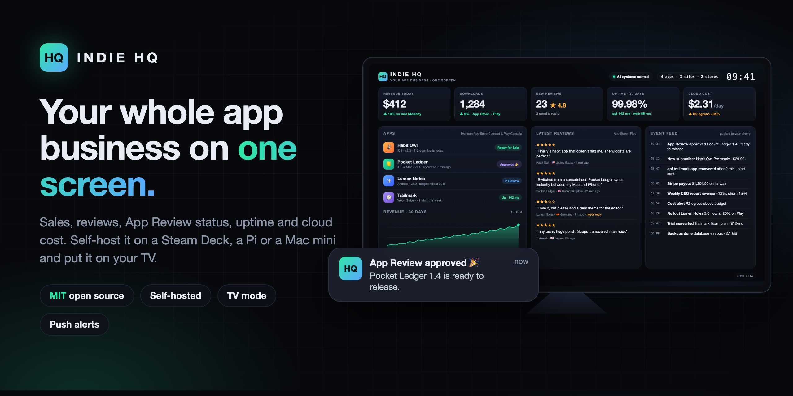
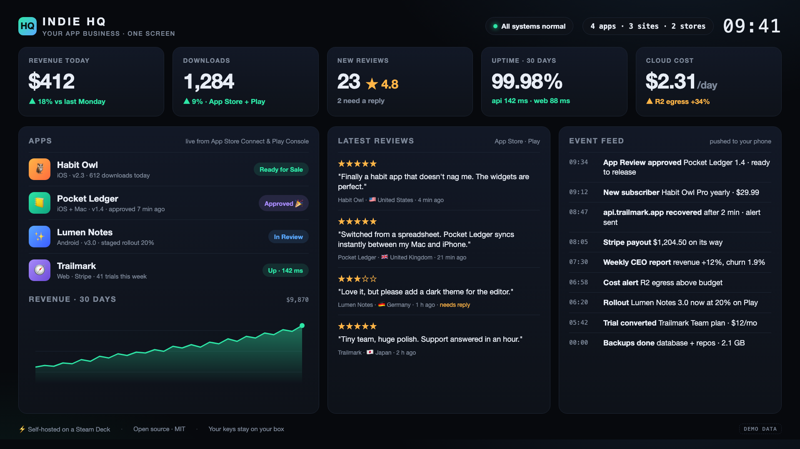
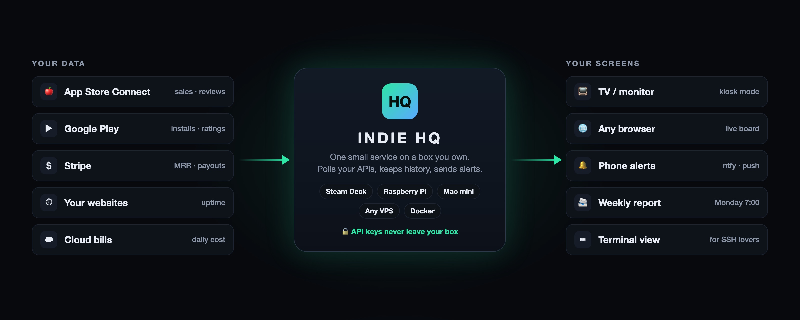

# Indie HQ

### Your whole app business on one screen.

Sales, downloads, reviews, App Review status, uptime and cloud cost for every app you ship. Self-host it on a Steam Deck, a Raspberry Pi, a Mac mini or any VPS, and put it on your TV.

**⭐ Star and 👀 Watch this repo to get v0.1 the day it ships.**

---

## Why

You ship a few apps. Every morning you open App Store Connect, Play Console, Stripe, your uptime checker and three cloud bills, just to answer one question: *is everything OK, and did we make money?*

Indie HQ answers it on one screen, all day, on the TV in your room. When something important happens, it taps you on the shoulder:

- 🎉 **App Review approved** for Pocket Ledger 1.4
- 💸 **New subscriber** on Habit Owl Pro
- 🔴 **api.yourapp.com is down**, and 2 minutes later it's back
- ⚠️ **Cloud cost** went over budget

Indie HQ grew out of the real board that runs our own company, [PT Jiji Labs Digital](https://jijilabsdigital.com), 24/7 on a Steam Deck. Now we're opening it up.

## The board

Demo data. Built for a 1080p or 1440p TV, and it scales down to a laptop screen.

## How it works

Indie HQ is one small service that runs **on a box you own**. It polls the APIs you connect, keeps the history in a local database, and serves a live board to your screens.

**Your API keys never leave your box.** No account with us, no upload, no telemetry. This also keeps you inside the store rules: App Store Connect and Google Play API keys are for your own team, so Indie HQ never sends them to a third-party server, including ours.

## Planned features for v0.1

| Area | What you get |
|---|---|
| **App Store Connect** | Units, proceeds, new reviews and ratings, App Review status for every version |
| **Google Play** | Installs, ratings, reviews, release and rollout status |
| **Stripe** | Revenue today, MRR, new subscribers, trials, payouts |
| **Uptime** | HTTP checks with response time for your sites and APIs |
| **Cloud cost** | Daily spend with a budget alert |
| **Screens** | Live web board, full-screen TV kiosk mode, terminal view |
| **Alerts** | Push to your phone through [ntfy](https://ntfy.sh), self-hosted or public |
| **Report** | Weekly summary every Monday morning |
| **Install** | One Docker command, or a native install on SteamOS, Raspberry Pi OS and macOS |

## Free and open source. Pro is optional.

| | **Indie HQ** (MIT) | **Indie HQ Pro** (planned) |
|---|:---:|:---:|
| Every connector, the web board and the TV kiosk | ✅ | ✅ |
| Phone alerts through ntfy | ✅ | ✅ |
| Self-hosted, your keys on your box | ✅ | ✅ |
| Native **Apple TV** app that connects to your own box | | ✅ |
| Native **iPhone** app with widgets and rich push | | ✅ |
| Price | **Free forever** | Small monthly fee |

Pro apps talk only to *your* Indie HQ box. We never hold your store or payment keys.

## Roadmap

- [ ] v0.1: App Store Connect, Stripe, uptime, web board, TV kiosk, Docker
- [ ] v0.2: Google Play, cloud cost, ntfy alerts, weekly report
- [ ] v0.3: Steam Deck and Raspberry Pi one-line installers
- [ ] Pro: Apple TV and iPhone apps

Tell us what to build first. Vote or comment in the [waitlist issue](../../issues/1).

## FAQ

**Is it really free?**
Yes. The whole self-hosted board is MIT licensed: use it, change it, ship it. Pro adds native Apple TV and iPhone apps for people who want them.

**Do I need a Steam Deck?**
No. Any always-on box works: a Raspberry Pi 4/5, an old Mac mini, a NAS with Docker, or a USD 5 VPS. The Steam Deck is just what we use, and it's a fun one.

**Is my sales data safe?**
It stays on your box. Indie HQ has no cloud backend and sends no analytics.

**Who is behind it?**
[PT Jiji Labs Digital](https://jijilabsdigital.com), a small independent studio that makes calm, private apps such as [SHIPSAFE](https://github.com/ilyasaalmadani/shipsafe-macos) for the Mac.

## Contributing

The code lands here with v0.1. Until then, the best help is:

1. ⭐ Star the repo so we know you want it.
2. Tell us your stack (stores, payments, hosting) in the [waitlist issue](../../issues/1).
3. Share it with an indie dev who checks five dashboards before breakfast.

## License

[MIT](LICENSE) © 2026 PT Jiji Labs Digital

---

Ilyas A. Almadani · PT Jiji Labs Digital 
App Store, App Store Connect and Apple TV are trademarks of Apple Inc. Google Play is a trademark of Google LLC. Steam Deck is a trademark of Valve Corporation. Indie HQ is not affiliated with them.

